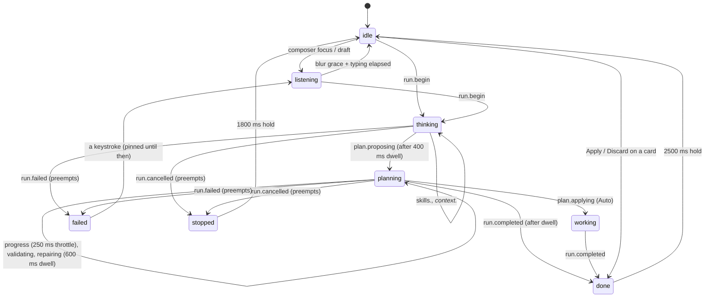

import { Canvas, Meta } from '@storybook/addon-docs/blocks';

import * as AgentFaceStories from './AgentFace.stories';

<Meta of={AgentFaceStories} />

# AgentFace

أبو غضب — Abu Ghadab, "father of anger": the person inside the Assistant. The tool is still called
Assistant everywhere the accessibility tree can see; the face and the one visible status line are
how that tool reads as a character who is grumpy, competent, and never in doubt about what he is
doing right now.

<Canvas of={AgentFaceStories.Thinking} />

## Purpose

An assistant that runs for several seconds needs to show what it is doing, and a spinner says only
"busy". The face carries the run's phase — reading, drafting, checking, repairing, applying — and
its outcome — proposed, applied, planned, discarded, failed, stopped — as geometry: brow angle, eye
shape, mouth path, ring dash pattern. The voice line says the same thing in words. Together they
replace the sparkle mark in the panel's header, reply avatars and empty state without moving a pixel
of layout: the three sizes are the three boxes the sparkle already occupied.

The brows do the acting. The resting grump is a shallow V; concentration deepens it; the earned
smile relaxes it but never flattens it. Flat brows appear in exactly one mood — stopped — because
surprise is the joke.

## When to use / not

Use `AgentFace` wherever the assistant is personified: the header (live), reply bubbles (frozen at
the mood the turn earned), the empty state. Use `AgentVoice` exactly once per panel, outside every
`aria-hidden` wrapper, so what is announced is exactly what people read.

Do not use the face as a status indicator for anything that is not the assistant, do not put a voice
beside every bubble (the card text already carries the state in words), and do not pass `live` to a
bubble face — a thread of a dozen animating avatars is noise, and the stylesheet forbids it for the
`sm` size regardless.

## Props

### AgentFace

| prop        | type                                                                                                | default | notes                                                      |
| ----------- | --------------------------------------------------------------------------------------------------- | ------- | ---------------------------------------------------------- |
| `mood`      | `'idle' \| 'listening' \| 'thinking' \| 'planning' \| 'working' \| 'done' \| 'failed' \| 'stopped'` | —       | required                                                   |
| `variant`   | `'checking' \| 'repairing'`                                                                         | —       | `planning` only; ignored elsewhere                         |
| `outcome`   | `'proposed' \| 'applied' \| 'planned' \| 'discarded'`                                               | —       | `done` only; ignored elsewhere                             |
| `typing`    | `boolean`                                                                                           | `false` | the listening nudge; drives `data-typing` and nothing else |
| `size`      | `'sm' \| 'md' \| 'lg'`                                                                              | `'md'`  | 24 / 32 / 48 px — the sparkle's three boxes                |
| `live`      | `boolean`                                                                                           | `false` | enables loops and one-shots; only the header passes it     |
| `className` | `string`                                                                                            | —       | appended to `pg-face`                                      |

The face is purely visual and stateless. It renders no text, never takes or moves focus, and its
`<svg>` is `aria-hidden` and `focusable="false"`.

### AgentVoice

| prop        | type                | default | notes                          |
| ----------- | ------------------- | ------- | ------------------------------ |
| `snapshot`  | `AgentMoodSnapshot` | —       | from `useAgentMood`            |
| `locale`    | `'ar' \| 'en'`      | `'ar'`  | the tier the line is read from |
| `className` | `string`            | —       | appended to `pg-face-voice`    |

Renders `
` with
`agentMoodText(snapshot, locale)`.

## The eight moods

Every pose at every size, captioned `mood — status line`. This grid is the copy deck: the English
tier is shown; the Arabic tier lives beside it in `AGENT_MOOD_COPY`.

<Canvas of={AgentFaceStories.AllMoods} />

| mood        | when                                                       | ring                                                 | motion (live only)                              |
| ----------- | ---------------------------------------------------------- | ---------------------------------------------------- | ----------------------------------------------- |
| `idle`      | nothing in flight, composer empty and unfocused            | hairline, `panel-border-strong`                      | a blink every 5.5 s                             |
| `listening` | composer focused or holding a draft (300 ms blur grace)    | solid 2, `accent-ring` — the composer's focus colour | none; typing nudges the mouth and features      |
| `thinking`  | `run.started` → `context.ready`                            | twelve static dots, `accent`                         | the slit eyes scan                              |
| `planning`  | `plan.proposing` / `progress` / `validating` / `repairing` | eight dashes, `accent`; `warning` while repairing    | the dashes drift; checking holds still          |
| `working`   | `plan.applying` (Auto mode only)                           | a 270° arc, `accent-strong`                          | spins at 900 ms — GenerationProgress's tempo    |
| `done`      | `run.completed`, or Apply / Discard pressed on a card      | solid `accent` / solid `success` / dashed / 25 dots  | the ring draws in (solid outcomes), a small pop |
| `failed`    | `run.failed`; pinned until a keystroke                     | broken in two places, `danger`                       | none — stillness is the signal                  |
| `stopped`   | `run.cancelled`; 1.8 s hold                                | the ⏻ shape: one gap with a tick, `panel-muted`      | one shake, then still                           |

## Done outcomes

`done` carries an `outcome` that the ring makes greyscale-safe: a proposal is a solid ring and a
smirk; an applied change is a solid `success` ring and the one symmetric smile; a plan that stays a
sketch keeps its dashes; a discarded plan is a dotted hairline ring and an eye-roll.

<Canvas of={AgentFaceStories.DoneApplied} />

## State machine

`reduceAgentMood` is the only place a mood is decided. It is a pure function of the run log with an
explicit `now`; the hook is a thin adapter that owns exactly one timer keyed on `wakeAt`.

Precedence when inputs conflict: an in-flight run owns the mood; then a pinned failure; then a
done/stopped hold; then the composer. Events are accepted only for the current run id with a higher
sequence number than the last, so a late `run.cancelled` after New chat is dropped and the reducer
returns a reference-equal state. `plan.proposed` changes nothing: the card announces the proposal,
and the face holds its last planning beat until `run.completed` so it never dips to idle in between.

<Canvas of={AgentFaceStories.Walkthrough} />

## Accessibility

- The `<svg>` is `aria-hidden` and `focusable="false"`, and the face always sits inside an
  `aria-hidden` wrapper. It has no accessible name and needs none: the panel's region is still named
  "Assistant".
- `AgentVoice` is the panel's single `role="status"` / `aria-live="polite"` / `aria-atomic` line. It
  carries `lang` for the tier it reads and `dir="auto"` so the content's own first strong character
  sets its direction. Idle and listening share one line so focus and keystrokes never announce;
  typing is `data-typing` only.
- **Focus is never moved**, on mount or when the mood changes. A test asserts this through every
  pose.
- **Colour never carries a state alone**: every mood has its own brow angle, eye shape, mouth path
  and ring dash pattern, and the voice says the same thing in words.
- `prefers-reduced-motion: reduce` removes every loop and one-shot and every transition. Nothing is
  lost — the geometry already says it.

## Styling

Every declaration reads a `--bldr-*` chrome token; none reads `--t-*`. The disc is `accent-soft`,
the ink is `panel-text`, the rings read `accent`, `accent-strong`, `accent-ring`, `success`,
`warning`, `danger`, `panel-muted` and `panel-border-strong`. Stroke widths are viewBox units, so
one drawing renders at three scales.

`--pg-face-glow` is an optional inherited variable: `.pg-chat` defines it in App.css alongside the
chat's other literals, and outside the chat it is transparent.

<Canvas of={AgentFaceStories.InsideChat} />

<Canvas of={AgentFaceStories.DarkTheme} />

## Hover — he notices you

The owner's rule: hovering the face has to express something and feel interactive. It does, and it
does it in CSS alone. The face stays stateless — no prop, no reducer input, no React state — the
voice line says exactly what it said before, and the pose is the browser's own `:hover`, so it costs
nothing while the run is busy.

<Canvas of={AgentFaceStories.Hover} />

- **A settled face lifts a brow.** In idle, listening, done and failed the outer brow arches 6°
  further and rises one unit — "what do you want?" — while the inner one presses half a unit, so the
  V is never lost. The arch composes with each mood's own angle: listening goes −4° → −10°, done −5°
  → −11°, failed −30° → −36°, a glare.
- **Busy moods answer with the halo and the lean only.** Thinking, planning and working do not look
  up; the voice already says "Working. Don't interrupt."
- **Stopped never lifts a brow.** Flat brows are that mood's joke, and hover does not spoil it.
- **Every mood notices.** The eyes widen 12 %, the disc leans in 5 %, and the halo widens from 8 to
  12 px (`--bldr-space-md` → `--bldr-space-xl`), colour paired with geometry.
- **Arrival.** The live face perks once — a 240 ms nod — when the pointer lands. It is scoped away
  from the moods whose features already animate (repairing's tilt, stopped's shake).
- **Press boops the disc** to 96 %, from `:active` or from a seat holding `data-press`. No action,
  no focus, no text; it releases over `--bldr-duration-move`.
- **The mouth, the ring and the tick never change on hover.** Mouths are earned by outcomes; the
  ring is run state. A test forbids any hover rule from naming them.

Geometry eases over `--bldr-duration-move` (180 ms) both ways and the halo over
`--bldr-duration-state` (120 ms); the transitions name their properties (`transform`, `translate`,
`rotate`, `scale`) and never `all`. The pose lives inside `@media (hover: hover)`: on touch there is
no hover, and a pose would stick.

### The seat contract

The face reads; whoever holds it writes. A seat — the header's brand mark, the empty-state mark —
sets two custom properties and one attribute on its own element, and nothing else crosses that line:

| written on the seat | value                         | read by                                        |
| ------------------- | ----------------------------- | ---------------------------------------------- |
| `--pg-face-look-x`  | a px length, −1.4px … 1.4px   | the eyes' `translate` (×1), the features' (×¼) |
| `--pg-face-look-y`  | a px length, −1px … 1px       | the same, plus the mood's own resting gaze     |
| `data-press`        | present while a press is held | the disc's boop                                |

Absent properties mean straight ahead. The eyes lead and the face turns a quarter as far, and the
`translate` transition turns per-frame writes into a smooth pursuit. The look is off in thinking
(the scan owns the eyes), stopped (one eye is shut) and failed (stillness is the signal). The
panel's hook writes the properties on the seat, never on the face, so a reply avatar can never
inherit them.

<Canvas of={AgentFaceStories.LooksAtThePointer} />

Life without a pointer: listening eyes rest 0.8 units lower, toward the focused composer
(`--pg-face-gaze-y`), and a live idle face throws a sideways glance every 9 s beside its blink.

- The `sm` size never reacts: every hover, look and press rule excludes it, and bubble faces neither
  pose nor follow.
- Under `prefers-reduced-motion: reduce` the perk and the glance are off with every other loop,
  hover and press poses snap without a transition (a state, not a motion), and `--pg-face-look-gain`
  goes to 0 so the eyes never follow — at any specificity, with no rule to out-rank.

## RTL

The stylesheet uses no physical properties. The only horizontal moves — the scan, the shake and the
glance — are symmetric. The asymmetric brows (listening, checking, discarded) and the hover arch are
a face, not text, and are deliberately not mirrored. The look is screen-space: the seat converts
pointer coordinates and the eyes translate in the drawing's own x, so he looks toward the pointer in
either direction. The component never sets `dir`; only the voice line follows the content direction,
from its own text.

<Canvas of={AgentFaceStories.RightToLeft} />

## Limitations

- No lip-sync to streamed text. `plan.progress` is shown verbatim, throttled to one publish per 250
  ms, and the mouth does not move with it.
- One voice per panel. Bubble faces are frozen and silent; the card text beside them already says
  what happened.
- The `sm` size never animates, poses, follows or boops, even if a caller passes `live`.
- Hover needs a real pointer. Touch gets the press boop and nothing else, and the look is only as
  fluid as the seat's writes — the panel coalesces them to one per animation frame.
- The face cannot say why it is looking. The pose is decoration; anything a person must know is in
  the voice line or the card.
