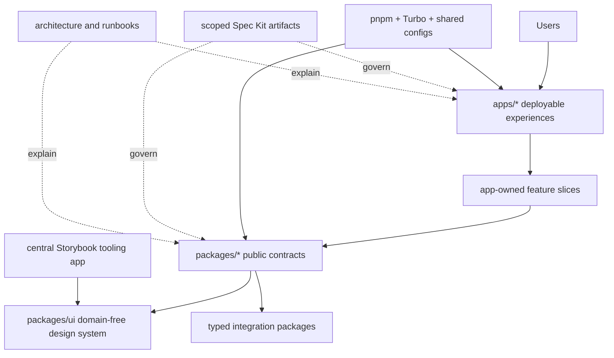

# System Architecture Overview

**Status:** Current workspace foundation plus one private local product application.

## Purpose

CraftKit is planned as a large multi-application frontend monorepo. The root workspace owns shared
governance and tooling, applications own deployable product experiences, and packages own deliberate
reusable contracts.



## Ownership Model

- `apps/<app>` owns a deployable application, its routing, composition, product features, app
  configuration, and app-only assets.
- `packages/ui` owns reusable domain-agnostic UI primitives and design-system contracts.
- `packages/<domain>` owns an explicit reusable domain contract only when multiple consumers justify
  that boundary.
- `packages/<integration>` owns transport and typed external-system boundaries.
- `packages/<tooling>` owns shared TypeScript, lint, test, Storybook, or build configuration.
- `apps/storybook` owns the one workspace UI catalog and is not a product deployable.
- `apps/adaptive-spec-router` owns a private local product trial for explainable task routing, dual
  plan-review freshness, and evidence visibility. It has no backend or deployment target.
- `packages/builder/*` owns the visual builder as a kernel-plus-extensions family under the layer
  law of [ADR 0003](decisions/0003-builder-dependency-law.md). It models both a single document and
  a whole SITE — pages, shared regions, a design system and an asset table — as one kernel with
  pages as lenses, recorded in [ADR 0006](decisions/0006-builder-site-model-and-design-tokens.md).
  Applications reach the family through the `@craftkit/builder` preset and nothing deeper.
- `apps/playground` owns the builder's local harness: the canvas, the inspector, and the AI
  assistant that generates a whole site from one description. It is a development surface, not a
  deployable.
- `.specify/` owns governance, agent workflows, and feature-delivery artifacts.
- `docs/` explains architecture and repeatable engineering or operational practice.

## Dependency Direction

Composition flows downward from application shells to feature slices and then to package public
APIs. Applications never import other applications, and packages never import applications.
Dependencies between packages must remain acyclic.

```text
app shell -> route -> feature composition -> feature modules -> package public APIs
```

## Workspace Runtime

Node 24 LTS, pnpm 11, and Turborepo 2 own repository tooling. The root graph discovers direct
members, packages use explicit exports, internal edges use `workspace:*`, and the repository
validators plus Turbo Boundaries enforce dependency direction. The complete commands and cache model
are documented in [monorepo.md](monorepo.md) and [workspace.md](../development/workspace.md).

## Product Runtime and Deployment

Adaptive Spec Router is a browser-only Vite React local demo. Its deterministic data stays in
memory; it has no authentication, external service, repository access, or deployed runtime. This
bounded app decision is recorded in [ADR 0005](decisions/0005-adaptive-spec-router-local-demo.md).

Future product runtime and deployment choices remain undecided. When those choices are made, update
this document with:

- deployable application inventory and responsibilities;
- browser/server/edge execution boundaries;
- authentication and tenant boundaries;
- external services and data ownership;
- build and release topology;
- observability and failure containment; and
- links to the approving ADRs and scoped specifications.

## Staleness Condition

Revisit this overview when the first application is scaffolded, a new deployable is added, a package
changes ownership, the builder's document/site model changes, or runtime/deployment boundaries
change.
